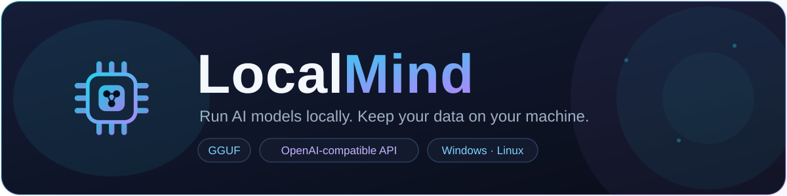

<div align="center">



[](LICENSE)
[](#-راه‌اندازی)
[](#۲-دانلود-مدل)
[](https://github.com/Mozilla-Ocho/llamafile)
[](#-دسترسی-به-api)
[](#-مشارکت)

**🧠 اجرای مدل‌های هوش مصنوعی به‌صورت محلی — بدون ابر، بدون API Key، با حفظ کامل حریم خصوصی.**

[English](README.md) · [فارسی](README.fa.md)

</div>

---

## 📖 درباره پروژه

**LocalMind** یک ابزار سبک و چندسکویی برای اجرای مدل‌های هوش مصنوعی روی کامپیوتر شخصی با استفاده از Runtimeهای قابل‌جایگزین است.

هدف پروژه این است که اجرای مدل‌های محلی را ساده کند؛ **بدون اینکه به یک مدل، ارائه‌دهنده یا Runtime خاص محدود باشد.** یک مدل GGUF اضافه کنید، Runtime را انتخاب کنید و یک سرور هوش مصنوعی خصوصی روی سخت‌افزار خودتان خواهید داشت.

## ✨ قابلیت‌ها

- 🧠 **اجرای هر مدل محلی** — محدود به مدل یا ارائه‌دهنده خاصی نیست
- 📦 **پشتیبانی از GGUF** — سازگار با رایج‌ترین فرمت مدل‌های محلی
- 💻 **Windows و Linux** — لانچر اختصاصی برای هر پلتفرم
- ⚡ **شتاب‌دهی GPU** — انتخاب خودکار Backend در صورت پشتیبانی
- 🖥️ **اجرای فقط با CPU** — بدون نیاز به کارت گرافیک مجزا
- 🔀 **Runtime قابل‌تنظیم** — تعویض Runtime بدون تغییر روند کار
- 🌐 **Local API Server** — API سازگار با OpenAI در Runtimeهای مربوطه
- 🔒 **کاملاً خصوصی** — بدون حساب کاربری، بدون API Key، بدون تلمتری

## 🗂️ ساختار پروژه

```text
LocalMind/
├── runtime/
│   ├── windows/       # فایل اجرایی Runtime ویندوز
│   └── linux/         # فایل اجرایی Runtime لینوکس
├── models/            # فایل‌های GGUF شما
├── assets/            # لوگو و بنر
├── run.bat            # لانچر ویندوز
├── run.sh             # لانچر لینوکس
├── README.md
└── README.fa.md
```

## 📋 پیش‌نیازها

| پیش‌نیاز | توضیحات |
| ------- | ------- |
| سیستم‌عامل | Windows یا Linux |
| Runtime | یک Runtime سازگار (بخش [مرحله ۱](#۱-دانلود-runtime)) |
| مدل | فایل مدل پشتیبانی‌شده (بخش [مرحله ۲](#۲-دانلود-مدل)) |
| GPU *(اختیاری)* | درایور و Backend سازگار برای شتاب‌دهی |

> [!IMPORTANT]
> فایل‌های مدل و Runtime داخل این مخزن قرار **ندارند**. باید آن‌ها را جداگانه دانلود کرده و در مسیرهای مشخص‌شده قرار دهید.

## 🚀 راه‌اندازی

### ۱️⃣ دانلود Runtime

در نسخه اولیه، از [llamafile](https://github.com/Mozilla-Ocho/llamafile) به‌عنوان Runtime نمونه استفاده می‌شود.

**لینک دانلود:** [llamafile v0.10.6](https://github.com/mozilla-ai/llamafile/releases/tag/0.10.6)

فایل اجرایی متناسب با سیستم‌عامل خود را در پوشه مربوطه قرار دهید:

- **Windows:** `runtime/windows/llamafile.exe`
- **Linux:** `runtime/linux/llamafile`

> [!TIP]
> لانچر به‌صورت خودکار هر فایل اجرایی که **نام آن شامل `llama` باشد** را در پوشه Runtime پیدا می‌کند — نیازی به تغییر نام نیست.

ساختار پروژه به‌گونه‌ای طراحی شده که در آینده بتوان Runtimeهای دیگری را نیز به آن اضافه کرد.

### ۲️⃣ دانلود مدل

LocalMind به مدل خاصی محدود نیست — می‌توانید از **هر مدلی که Runtime انتخابی شما پشتیبانی می‌کند** استفاده کنید. یک یا چند فایل `.gguf` را در پوشه `models/` قرار دهید؛ لانچر لیست آن‌ها را نمایش می‌دهد و در هر اجرا امکان انتخاب مدل را می‌دهد.

#### مثال: Qwen3.8-2B

برای راه‌اندازی اولیه می‌توانید از این مدل استفاده کنید:

- مدل: [Qwen3.8-2B-Distill-GGUF](https://huggingface.co/empero-ai/Qwen3.8-2B-Distill-GGUF)
- نسخه پیشنهادی نمونه: `Qwen3.8-2B-Q6_K.gguf`

[⬇️ دانلود مستقیم Qwen3.8-2B-Q6_K.gguf](https://huggingface.co/empero-ai/Qwen3.8-2B-Distill-GGUF/resolve/main/Qwen3.8-2B-Q6_K.gguf?download=true)

سپس فایل را در مسیر زیر قرار دهید:

```text
models/
```

می‌توانید چندین مدل را همزمان نگه دارید و بین آن‌ها جابه‌جا شوید. هر زمان که خواستید فایل‌های `.gguf` را جایگزین یا اضافه کنید.

> [!NOTE]
> **سازگاری مدل به Runtime و نسخه آن بستگی دارد.** برای مثال، بعضی معماری‌های جدید به نسخه‌های جدیدتر llama.cpp نیاز دارند. قبل از انتخاب Runtime، الزامات مدل موردنظر را بررسی کنید.

### ۳️⃣ اجرای LocalMind

**Windows** — فایل `run.bat` را اجرا کنید، یا از طریق ترمینال:

```powershell
.\run.bat
```

**Linux** — ابتدا مجوز اجرا را فعال کنید و سپس اجرا کنید:

```bash
chmod +x run.sh
./run.sh
```

لانچر Runtime را شناسایی می‌کند، مدل‌های موجود را لیست می‌کند و پس از انتخاب شما، سرور را اجرا می‌کند.

## 🌐 دسترسی به API

پس از اجرای موفق سرور، از طریق آدرس زیر در دسترس خواهد بود:

```text
http://127.0.0.1:8080
```

در Runtimeهایی که API سازگار با OpenAI ارائه می‌دهند، Endpoint چت معمولاً به شکل زیر است:

```text
http://127.0.0.1:8080/v1/chat/completions
```

نمونه درخواست:

```bash
curl http://127.0.0.1:8080/v1/chat/completions \
  -H "Content-Type: application/json" \
  -d '{
    "model": "local-model",
    "messages": [
      {
        "role": "user",
        "content": "Hello! Introduce yourself."
      }
    ],
    "temperature": 0.7
  }'
```

> [!NOTE]
> رفتار دقیق API به Runtime انتخابی بستگی دارد.

## ⚡ اجرای GPU و CPU

LocalMind از هر دو حالت شتاب‌دهی GPU و اجرای با CPU پشتیبانی می‌کند.

در اسکریپت نمونه llamafile از تنظیم زیر برای انتخاب خودکار Backend استفاده شده است:

```bash
--gpu auto -ngl 999
```

این تنظیم تلاش می‌کند Backend مناسب را به‌صورت خودکار انتخاب کرده و لایه‌های مدل را به GPU منتقل کند. استفاده واقعی از GPU به نسخه Runtime، Backend نصب‌شده، درایورها و سخت‌افزار بستگی دارد.

برای اجرای صرفاً CPU:

```bash
--gpu disable -ngl 0
```

> [!WARNING]
> انتخاب خودکار GPU لزوماً به معنی انتقال بدون خطا به CPU در صورت شکست راه‌اندازی GPU نیست.

## ⚙️ تنظیمات

تنظیمات پیش‌فرض اسکریپت‌ها:

| تنظیم      | مقدار پیش‌فرض |
| ---------- | ------------- |
| Runtime    | llamafile     |
| مدل        | هر فایل `.gguf` در `models/` (انتخاب هنگام اجرا) |
| Host       | `127.0.0.1`   |
| Port       | `8080`        |
| GPU mode   | `auto`        |
| GPU layers | `999`         |

می‌توانید این مقادیر را در فایل‌های `run.bat` و `run.sh` تغییر دهید.

## 🔒 امنیت

به‌صورت پیش‌فرض سرور روی آدرس `127.0.0.1` اجرا می‌شود و **فقط از همان کامپیوتر** قابل دسترسی است.

> [!CAUTION]
> بدون پیاده‌سازی احراز هویت و کنترل دسترسی مناسب، سرور را در معرض شبکه عمومی قرار ندهید.

## 🗺️ نقشه راه

- [ ] پشتیبانی از Runtimeهای بیشتر
- [ ] تشخیص خودکار سخت‌افزار و GPU
- [ ] مدیریت تنظیمات Runtime
- [ ] بهبود انتخاب مدل
- [ ] مدیریت دانلود مدل‌ها
- [ ] تنظیم Context و پارامترهای Inference
- [ ] بهبود پشتیبانی چندسکویی
- [ ] رابط گرافیکی ساده
- [ ] یکپارچه‌سازی API سازگار با OpenAI برای Runtimeهای پشتیبانی‌شده

## 🤝 مشارکت

گزارش باگ‌ها، پیشنهادها و مشارکت در توسعه پروژه **مورد استقبال است!**

برای اضافه کردن Runtime یا فرمت مدل جدید می‌توانید [Issue ایجاد کنید](https://github.com/Ryan-PG/LocalMind/issues) یا Pull Request ارسال کنید.

1. مخزن را Fork کنید
2. شاخه ویژگی خود را بسازید (`git checkout -b feature/amazing-feature`)
3. تغییرات را Commit کنید (`git commit -m 'Add some amazing feature'`)
4. شاخه را Push کنید (`git push origin feature/amazing-feature`)
5. یک Pull Request باز کنید

## 📄 مجوز

این پروژه تحت مجوز MIT منتشر شده است. برای اطلاعات بیشتر فایل [LICENSE](LICENSE) را مطالعه کنید.

---

<div align="center">

**LocalMind** — مدل‌های شما. سخت‌افزار شما. داده‌های شما. 🧠

</div>
