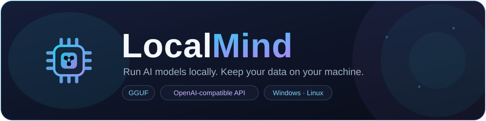

<div align="center">



[](LICENSE)
[](#-getting-started)
[](#2-download-a-model)
[](https://github.com/Mozilla-Ocho/llamafile)
[](#-local-api)
[](#-contributing)

**🧠 Run AI models locally — no cloud, no API keys, no data leaving your machine.**

[English](README.md) · [فارسی](README.fa.md)

</div>

---

## 📖 About

**LocalMind** is a lightweight, cross-platform launcher for running local AI models using interchangeable inference runtimes.

It makes local AI inference straightforward — **without tying the project to a specific model, model provider, or runtime.** Drop in a GGUF model, pick a runtime, and you have a private AI server running on your own hardware in seconds.

## ✨ Features

- 🧠 **Run any local model** — not locked to a specific model or provider
- 📦 **GGUF support** — works with the most popular local model format
- 💻 **Windows & Linux** — native launcher for each platform
- ⚡ **GPU acceleration** — automatic GPU backend selection when supported
- 🖥️ **CPU-only inference** — works without a discrete GPU
- 🔀 **Configurable runtime** — swap inference runtimes without changing your workflow
- 🌐 **Local API server** — OpenAI-compatible chat completions when supported by the runtime
- 🔒 **100% private** — no cloud account, no API keys, no telemetry

## 🗂️ Project Structure

```text
LocalMind/
├── runtime/
│   ├── windows/       # Windows runtime executable
│   └── linux/         # Linux runtime executable
├── models/            # Your GGUF model files
├── assets/            # Logo and banner
├── run.bat            # Windows launcher
├── run.sh             # Linux launcher
├── README.md
└── README.fa.md
```

## 📋 Requirements

| Requirement | Details |
| ----------- | ------- |
| Operating System | Windows or Linux |
| Runtime | A compatible inference runtime (see [Step 1](#1-download-an-inference-runtime)) |
| Model | A supported model file (see [Step 2](#2-download-a-model)) |
| GPU *(optional)* | Compatible driver + runtime backend for acceleration |

> [!IMPORTANT]
> This repository does **not** include model files or runtime binaries. You must download them separately and place them in the directories shown above.

## 🚀 Getting Started

### 1️⃣ Download an Inference Runtime

LocalMind currently uses [llamafile](https://github.com/Mozilla-Ocho/llamafile) as its example runtime.

**Download:** [llamafile Releases](https://github.com/mozilla-ai/llamafile/releases/tag/0.10.6)

Place the executable for your operating system in the matching folder:

- **Windows:** `runtime/windows/llamafile.exe`
- **Linux:** `runtime/linux/llamafile`

> [!TIP]
> The launcher automatically detects any executable whose **filename contains `llama`** in the runtime folder — no renaming required if you keep the original name.

The runtime is fully replaceable. Other compatible runtimes can be integrated in the future.

### 2️⃣ Download a Model

LocalMind is not limited to a particular model — use **any model format supported by your selected runtime**. Drop one or more `.gguf` files into the `models/` folder, and the launcher will list them and let you choose at startup.

#### Example: Qwen3.8-2B

For the initial setup, you can use:

- Model: [Qwen3.8-2B-Distill-GGUF](https://huggingface.co/empero-ai/Qwen3.8-2B-Distill-GGUF)
- Example quantization: `Qwen3.8-2B-Q6_K.gguf`

[⬇️ Download Qwen3.8-2B-Q6_K.gguf](https://huggingface.co/empero-ai/Qwen3.8-2B-Distill-GGUF/resolve/main/Qwen3.8-2B-Q6_K.gguf?download=true)

Then place it inside:

```text
models/
```

You can keep multiple models and switch between them every time you launch. Replace or add `.gguf` files whenever you want.

> [!NOTE]
> **Model compatibility depends on the inference runtime and its version.** Some newer model architectures require newer llama.cpp builds. Always check the selected model's requirements before choosing a runtime version.

### 3️⃣ Run LocalMind

**Windows** — double-click `run.bat`, or from a terminal:

```powershell
.\run.bat
```

**Linux** — make the launcher executable, then run it:

```bash
chmod +x run.sh
./run.sh
```

The launcher will detect your runtime, list the available models, and start the server once you pick one.

## 🌐 Local API

When the server starts successfully, it will be available at:

```text
http://127.0.0.1:8080
```

For runtimes that provide an OpenAI-compatible API, the chat completion endpoint is typically:

```text
http://127.0.0.1:8080/v1/chat/completions
```

Example request:

```bash
curl http://127.0.0.1:8080/v1/chat/completions \
  -H "Content-Type: application/json" \
  -d '{
    "model": "local-model",
    "messages": [
      {
        "role": "user",
        "content": "Hello! Introduce yourself."
      }
    ],
    "temperature": 0.7
  }'
```

> [!NOTE]
> The exact API behavior depends on the selected runtime.

## ⚡ GPU and CPU Execution

LocalMind supports both GPU-accelerated and CPU-only inference.

The example llamafile launcher uses automatic GPU backend selection:

```bash
--gpu auto -ngl 999
```

This requests automatic backend selection and GPU layer offloading. Actual GPU usage depends on the runtime build, available backend, drivers, and hardware.

To explicitly use CPU-only inference:

```bash
--gpu disable -ngl 0
```

> [!WARNING]
> Automatic GPU selection should not be treated as a guarantee of seamless CPU fallback if GPU initialization fails.

## ⚙️ Configuration

The launcher scripts use the following default settings:

| Setting    | Default        |
| ---------- | -------------- |
| Runtime    | llamafile      |
| Model      | Any `.gguf` in `models/` (selected at startup) |
| Host       | `127.0.0.1`    |
| Port       | `8080`         |
| GPU mode   | `auto`         |
| GPU layers | `999`          |

You can modify these values in `run.bat` or `run.sh`.

## 🔒 Security

By default, the server listens on `127.0.0.1`, making it accessible **only from the local machine**.

> [!CAUTION]
> Do not expose the server to a public network without implementing appropriate authentication and access controls.

## 🗺️ Roadmap

- [ ] Support additional inference runtimes
- [ ] Automatic hardware and GPU detection
- [ ] Runtime configuration
- [ ] Model selection improvements
- [ ] Model download management
- [ ] Context and inference configuration
- [ ] Cross-platform improvements
- [ ] Simple graphical interface
- [ ] OpenAI-compatible API integration across supported runtimes

## 🤝 Contributing

Contributions, bug reports, and suggestions are **welcome!**

If you want to add support for another runtime or model format, feel free to [open an issue](https://github.com/Ryan-PG/LocalMind/issues) or submit a pull request.

1. Fork the repository
2. Create your feature branch (`git checkout -b feature/amazing-feature`)
3. Commit your changes (`git commit -m 'Add some amazing feature'`)
4. Push to the branch (`git push origin feature/amazing-feature`)
5. Open a Pull Request

## 📄 License

Distributed under the MIT License. See [LICENSE](LICENSE) for more information.

---

<div align="center">

**LocalMind** — Your models. Your hardware. Your data. 🧠

</div>
